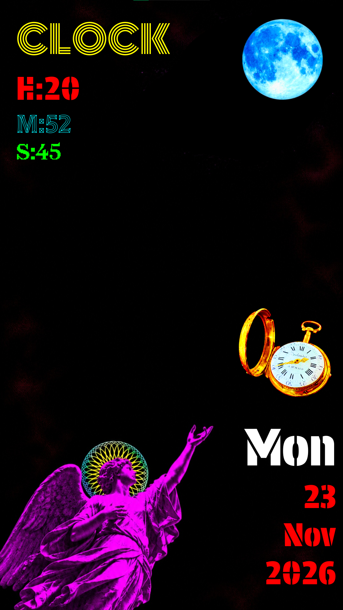
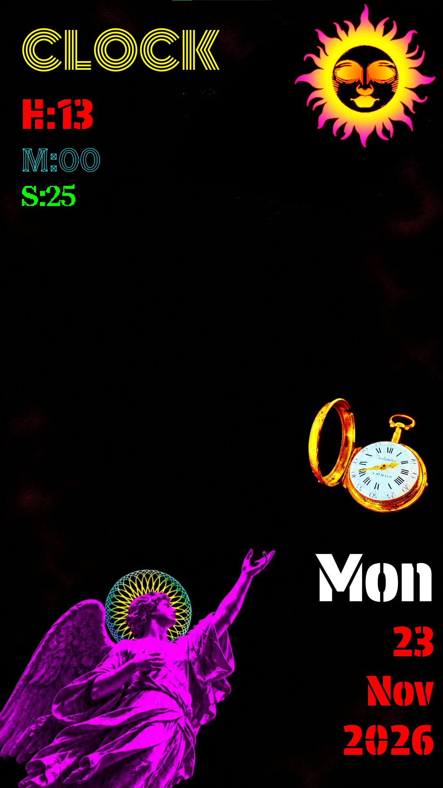

# smart-mirror-pyside

A work-in-progress smart mirror display built with Python and PySide6. It shows a stylized digital clock, the current date, an animated pocket watch, and a sun / sunset / moon icon that changes with the real sun position at your location.

> **Status:** WIP. The layout is tuned for a single screen and many values are still hard-coded.




## Features

- Digital clock (hours, minutes, seconds), each with its own font and color
- Date display (weekday, day, month, year)
- Pocket watch widget drawn from PNG layers, with rotating hands on a tilted, squashed ellipse
- Day / sunset / night icon, chosen from sunrise and sunset times calculated with [astral](https://github.com/sffjunkie/astral)
- Fullscreen kiosk-style window

## Requirements

- Python 3.10+
- [PySide6](https://pypi.org/project/PySide6/)
- [astral](https://pypi.org/project/astral/)

```bash
pip install PySide6 astral
```

## Project structure

```
smart-mirror-pyside/
├── main.py
├── fonts/        # .ttf files loaded at startup
├── icons/        # sun.png, sunrise.png, moon.png
└── pictures/     # background.png, watch.png, Watch_Hours.png, Watch_Minutes.png
```

## Running

```bash
python main.py
```

Controls:

| Key   | Action                    |
|-------|---------------------------|
| `F11` | Toggle fullscreen         |
| `Esc` | Close the application     |

## Configuration

Everything is currently configured with constants at the top of `main.py`:

| Constant                         | Purpose                                              |
|----------------------------------|------------------------------------------------------|
| `TZ`, `LOCATION`                 | Timezone and coordinates used for sunrise / sunset   |
| `STYLES`                         | Font family, size and color of each label            |
| `PHASE_TO_ICON`                  | Mapping from day phase to icon file name             |
| `CENTER`, `PIVOTS`               | Pocket watch hand pivot points (in source pixels)    |
| `AXIS_ANGLE`, `SQUASH`           | Tilt and flattening of the watch's ellipse           |
| `SPEED`                          | Pocket watch hand speed (decorative, see below)      |
| `WATCH_POS`                      | Watch position as a fraction of the window size      |

To use it in your own location, change `TZ` and the `LOCATION` coordinates.

### Notes

- The pocket watch is a **decorative animation**: its hands run at `SPEED`× real time starting from program launch and do not show the actual time. The digital clock does.
- The layout is designed for a **portrait 1080×1920** display. Margins and sizes are hard-coded, so other resolutions will need adjusting.
- Fonts are looked up by family name: Monoton, Protest Guerrilla, Tilt Prism and Redaction 35. Put the `.ttf` files in `fonts/`.

## Customization

The background and the day-phase icons are plain PNG files, so you can replace them with your own artwork without touching the code. Just keep the file names:

| File                        | Used for                                   |
|-----------------------------|--------------------------------------------|
| `pictures/background.png`   | Window background (designed for 1080×1920) |
| `icons/sun.png`             | Daytime icon                               |
| `icons/sunrise.png`         | Icon shown around sunset                   |
| `icons/moon.png`            | Nighttime icon                             |

Icons are scaled to fit automatically (400 px by default, see `load_icons`). Transparent PNGs work best.

The pocket watch images (`watch.png`, `Watch_Hours.png`, `Watch_Minutes.png`) can be replaced too, but you will also need to adjust `CENTER`, `PIVOTS`, `AXIS_ANGLE` and `SQUASH` in `main.py` so the hands line up with your watch face.

## Assets and licenses

- **Code:** MIT License (see `LICENSE`).
- **Graphics** (`pictures/` and `icons/`): created by me, released under the same MIT License
- **Fonts** (`fonts/`): not mine. Monoton, Protest Guerrilla, Tilt Prism and Redaction 35 are distributed under the [SIL Open Font License 1.1](https://openfontlicense.org). Each font's copyright notice and license text are included in `fonts/licenses/`.

## Roadmap

- [ ] Move configuration to a separate config file
- [ ] Responsive layout for other resolutions
- [ ] Refactor labels into class attributes and use a single update timer
- [ ] Additional widgets (weather, calendar, etc.)

